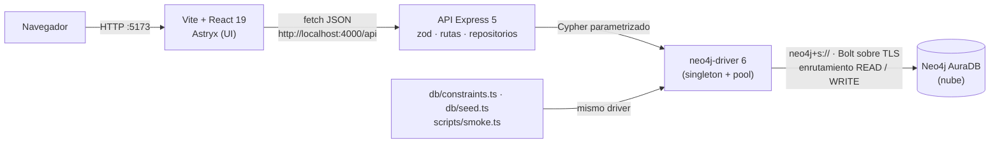

# Arquitectura

## Capas

| Capa | Dónde | Responsabilidad |
|---|---|---|
| **Navegador / Web** | `apps/web` | Interfaz en español con componentes de Astryx (`AppShell`, `TopNav`, `Table`, `Dialog`, `Selector`…). `src/api/client.ts` es el único lugar que hace `fetch`; convierte errores HTTP en `ApiError` con el mensaje del servidor (p. ej. los 409 de referidos). |
| **Rutas** | `apps/api/src/routes` | Un router de Express por recurso. Solo validan la entrada con zod (`schemas/`) y delegan; no contienen Cypher. |
| **Repositorios** | `apps/api/src/repositories` | Orquestan las consultas: eligen lectura o escritura, abren transacciones cuando hay varias escrituras dependientes, convierten enteros con `neo4j.int()` y traducen "sin filas" en 404/409 con un motivo claro. |
| **Consultas** | `apps/api/src/queries` | **Todo el Cypher del proyecto**, una constante por consulta, con propósito, parámetros y ejemplo. De aquí se genera `docs/consultas.md`. |
| **Driver** | `apps/api/src/db/driver.ts` | Un solo `Driver` por proceso. `verifyConnectivity`/`getServerInfo` antes de abrir el puerto; `executeQuery` con `routing: READ/WRITE`; `session.executeWrite` para transacciones; cierre ordenado en `SIGINT/SIGTERM`. |
| **Serialización** | `apps/api/src/db/serialize.ts` | Convierte `Date`/`DateTime` de Neo4j a strings ISO antes de responder JSON. |
| **Errores** | `apps/api/src/middleware/errores.ts` | `ZodError` → 400, `HttpError` → su status, `ConstraintValidationFailed` → 409, todo lo demás → 500 sin detalles internos. |
| **Base de datos** | Neo4j AuraDB | Grafo en la nube. La URI `neo4j+s://` indica: protocolo Bolt, cifrado TLS con certificado verificado y driver con enrutamiento (descubre el clúster y manda lecturas a cualquier miembro y escrituras al líder). |

## Flujo de una petición (ejemplo: registrar compra)

1. La UI llama `POST /api/compras` con `{clienteId, sku, cantidad}`.
2. `productos.routes.ts` valida el cuerpo con `crearCompraBody` (zod).
3. `compras.repository.ts` abre `session.executeWrite` y ejecuta `REGISTRAR_COMPRA` con `cantidad: neo4j.int(n)`.
4. Si no hubo filas, dentro de la misma transacción corre `DIAGNOSTICO_COMPRA` y lanza 404 o 409 ("Stock insuficiente…").
5. El driver confirma la transacción; la UI incrementa su `version` y vuelve a pedir la ficha y las recomendaciones.

## Por qué grafo

Las dos preguntas del negocio son recorridos sobre relaciones:

- **Recomendaciones**: mascota → raza/tamaño → mascotas parecidas → dueños → productos que compraron. En SQL serían 5–6 JOINs con auto-join de la tabla de mascotas; en Cypher es un patrón de dos saltos.
- **Referidos**: red hasta 3 niveles (`REFIRIO*1..3`), cadena hacia arriba de profundidad desconocida (`REFIRIO*1..10`) y camino más corto (`shortestPath`). En SQL requiere CTE recursivas y control manual de ciclos; en el grafo la profundidad es solo un número en el patrón.
