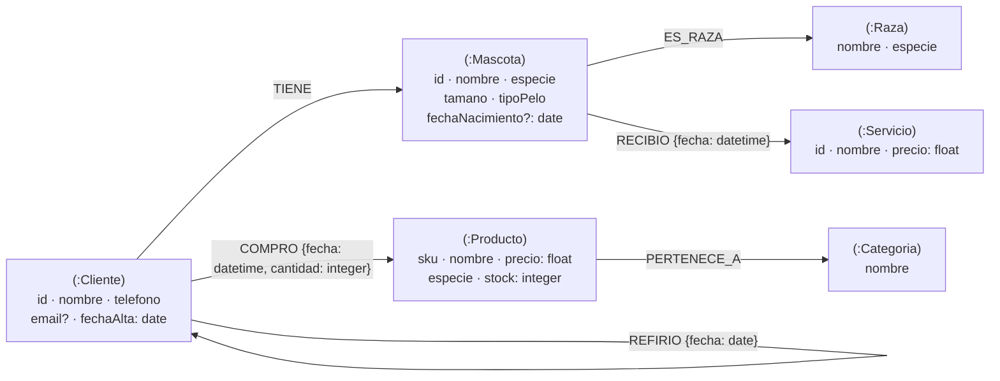

# Modelo de grafo

## Etiquetas

| Etiqueta | Propiedades | Valores permitidos |
|---|---|---|
| `Cliente` | `id` (string), `nombre`, `telefono` (único, 10 dígitos), `email` (opcional), `fechaAlta` (date) | — |
| `Mascota` | `id` (string), `nombre`, `especie`, `tamano`, `tipoPelo`, `fechaNacimiento` (date, opcional) | especie: `perro`, `gato` · tamano: `chico`, `mediano`, `grande` · tipoPelo: `corto`, `largo`, `doble capa`, `rizado` |
| `Raza` | `nombre` (único), `especie` | 10 de perro y 3 de gato |
| `Producto` | `sku` (único), `nombre`, `precio` (float MXN), `especie`, `stock` (integer) | especie: `perro`, `gato`, `ambos` |
| `Categoria` | `nombre` (único) | `Shampoos`, `Alimentos`, `Accesorios`, `Juguetes` |
| `Servicio` | `id` (único), `nombre`, `precio` (float MXN) | Baño, Baño y corte, Deslanado, Corte de uñas, Guardería por día, Hotel por noche |

## Constraints e índices (`db/constraints.cypher`)

- Unicidad: `Cliente.id`, `Cliente.telefono`, `Mascota.id`, `Producto.sku`, `Raza.nombre`, `Categoria.nombre`, `Servicio.id`.
- Índice de búsqueda: `Cliente.nombre`.

Las constraints de unicidad crean además un índice, por lo que todos los `MATCH (x {id: $id})` son búsquedas indexadas.

## Reglas de integridad que impone la aplicación

El grafo no puede expresar estas reglas con constraints, así que la API las hace cumplir:

| Regla | Dónde se aplica |
|---|---|
| Un cliente solo puede ser referido por una persona (máximo una `REFIRIO` entrante) | `CREAR_REFERIDO`: `NOT EXISTS { ()-[:REFIRIO]->(b) }` |
| Sin auto-referencias | `CREAR_REFERIDO`: `a <> b` (y validación previa en el repositorio) |
| Sin ciclos de referidos | `CREAR_REFERIDO`: `NOT EXISTS { (b)-[:REFIRIO*]->(a) }` |
| Una mascota pertenece a un solo cliente | Las mascotas solo se crean con `POST /clientes/:id/mascotas` (una `TIENE` al crearla) y no hay endpoint para reasignarlas |
| La raza de una mascota es de su misma especie | `CREAR_MASCOTA` y `CAMBIAR_RAZA_MASCOTA` filtran `r.especie = m.especie`; la especie de una mascota no se puede editar |
| No se vende más de lo que hay en stock | `REGISTRAR_COMPRA`: `WHERE p.stock >= $cantidad` dentro de una transacción de escritura |

Cuando una regla falla, la escritura no devuelve filas; el repositorio ejecuta una consulta de diagnóstico para responder **409** con el motivo concreto (por ejemplo, "Este cliente ya fue referido por otra persona (José Luis Hernández)").
